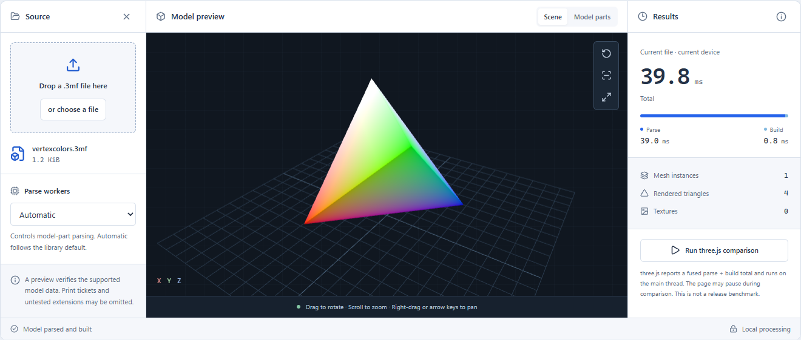
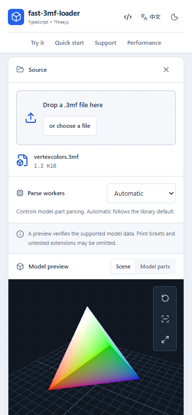
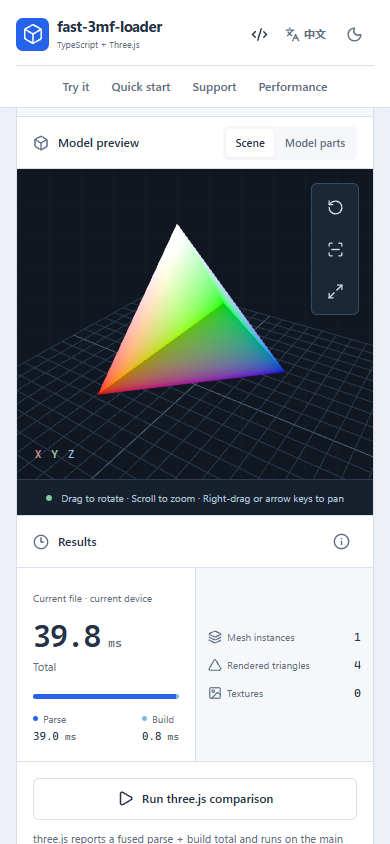
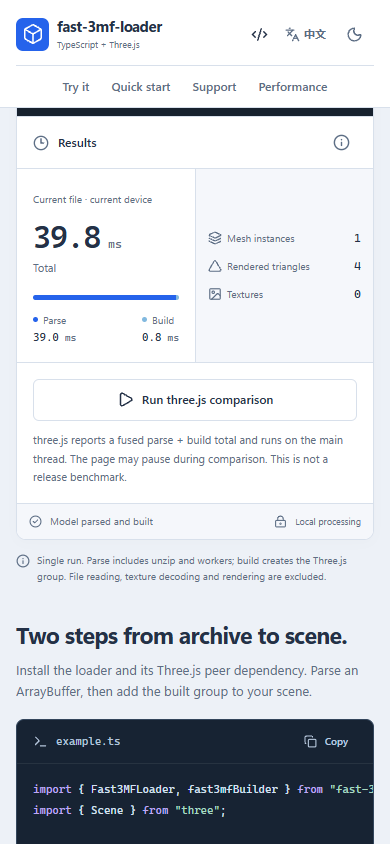

# fast-3mf-loader

[English](README.md) | [简体中文](README-zh.md)

面向浏览器的 TypeScript 3MF 解析与 Three.js 构建库。内部采用 SAX 风格流式解析，并用 WebWorker 分担大型模型零件的解析。

[](https://github.com/Innovgame/fast-3mf-loader/actions/workflows/ci.yml)
[](https://www.npmjs.com/package/fast-3mf-loader)
[](https://github.com/Innovgame/fast-3mf-loader/releases)
[](LICENSE)

> [!WARNING]
> 项目仍在早期开发。稳定 1.0 发布前，公开 API 可能调整。请谨慎用于生产环境。

打开[浏览器验证页](https://innovgame.github.io/fast-3mf-loader/)，可以在本机预览 3MF 文件，并测量解析与构建耗时。文件留在浏览器内，不会上传。



### 手机验证页

同一页面在手机上会把文件区、模型预览和耗时叠成一屏。

<p>
  
  
  
</p>

## 安装

当前版本 `0.0.8`。变更记录见 [CHANGELOG.md](CHANGELOG.md)。

`three` 是 peer dependency，需要和解析库一起安装。

### npm

```bash
npm install fast-3mf-loader three
```

```ts
import { Fast3MFLoader, fast3mfBuilder } from "fast-3mf-loader";
```

### GitHub Packages

先在 `.npmrc` 里写上，再安装 `@innovgame/fast-3mf-loader`：

```text
@innovgame:registry=https://npm.pkg.github.com
```

```bash
npm install @innovgame/fast-3mf-loader three
```

导入路径是 `@innovgame/fast-3mf-loader`。API 与 npm 包相同。

## 快速开始

```ts
import { Fast3MFLoader, fast3mfBuilder } from "fast-3mf-loader";

const response = await fetch("path/to/model.3mf");
const buffer = await response.arrayBuffer();
const loader = new Fast3MFLoader();
const data3mf = await loader.parse(buffer, {
    onProgress(progress) {
        console.log(`解析进度: ${progress}%`);
    },
});
const group = fast3mfBuilder(data3mf);
```

`parse()` 接收一份完整的 `ArrayBuffer`。把 `group` 添加到已有的 Three.js 场景即可。

验证页地址是 <https://innovgame.github.io/fast-3mf-loader/>。`3mf/` 中的样例是回归夹具，许可说明见 [3mf/README.md](3mf/README.md)。

## 限制

- 支持的运行环境是具备 `Worker` 与 `Blob` 的现代浏览器。worker 无法启动时，解析会抛出指向这一前提的 loader-facing error。
- `Fast3MFLoader#parse()` 接收 `ArrayBuffer`。内部采用 SAX 风格流式解析，以降低大型 archive 的内存压力。这不是公开的分块输入 API。
- Print Ticket，以及超出当前样例覆盖的扩展资源，尚未支持。解析器返回空的 `printTicket` 并发出 warning。
- Node 测试和基准使用兼容垫片，不构成受支持的 Node 运行时。
- 文档中的历史基准样本只说明当时的测量环境，不能直接预测浏览器速度。

## 它做什么

- 解压 3MF archive，并通过 `_rels/.rels` 定位根模型。
- 内部采用 SAX 风格流式解析，在大型 3MF archive 上帮助降低内存压力。
- 使用 WebWorker 并行解析 model parts。默认线程数是 `min(hardwareConcurrency - 1, 15)`，无法判断时回退到 `4`。非法 `workerCount` 会 warning 并使用该默认值。
- 从网格、顶点色、纹理和组件实例构建 `THREE.Group`，包括 Production 扩展里指向其他 model part 的 `path`。
- 通过 `onProgress` 报告进度。未支持的数据会 warning，而不是伪装成成功。

## 支持能力

证据和说明见 [docs/support-matrix.md](docs/support-matrix.md)。没有列在那里的能力，都应视为未支持。

| 能力 | 状态 |
| --- | --- |
| 压缩包解压与根关系 | 已支持 |
| 多对象、组件，以及 Production `path` 跨模型引用 | 已支持 |
| 网格几何 | 已支持 |
| 顶点颜色组 | 已支持 |
| 纹理资源、纹理组与模型关系 | 已支持 |
| Print Ticket | 暂未支持 |
| 超出当前样例覆盖的扩展资源 | 暂未支持 |

## API

从 npm 安装 `fast-3mf-loader`，或从 GitHub Packages 安装 `@innovgame/fast-3mf-loader`。

```ts
import { Fast3MFLoader, fast3mfBuilder } from "fast-3mf-loader";
import type { Model3MF, ParseOptions, ParsedModelPart, Relationship } from "fast-3mf-loader";

const data3mf: Model3MF = await new Fast3MFLoader().parse(buffer, {
    workerCount: 4,
    onProgress(progress) {
        console.log(progress);
    },
});
const group = fast3mfBuilder(data3mf);
```

| 导出 | 用途 |
| --- | --- |
| `Fast3MFLoader#parse` | 把 `ArrayBuffer` 解析为 `Model3MF` |
| `fast3mfBuilder` | 把解析结果构建为 `THREE.Group` |
| `Model3MF` | `ParseResult` 的文档别名 |
| `ParseOptions` | `workerCount` 与 `onProgress` |
| `ParsedModelPart` | 一个已解析的 `.model` 零件 |
| `Relationship` | 一条包关系 |

`Model3MF` 包含 `rels`、可选的 `modelRels`、`model`、`printTicket` 和 `texture`。在支持 Print Ticket 之前，`printTicket` 为空。不是 `ArrayBuffer` 的输入会在解析开始前被拒绝。

## 开发

需要 Node.js 22 和 pnpm 10。

```bash
git clone https://github.com/Innovgame/fast-3mf-loader.git
pnpm install
pnpm dev
```

`pnpm dev` 启动 React 项目页和浏览器验证区。

```bash
pnpm verify
pnpm test
pnpm build
```

推送到 `master` 的提交，以及目标分支为 `master` 的 pull request，会运行 [CI](.github/workflows/ci.yml)，其中包含 Pages 生产子路径的浏览器验证。`master` 上的 CI 成功后，页面会发布到 <https://innovgame.github.io/fast-3mf-loader/>。`pnpm --filter @fast-3mf-loader/demo test:e2e` 在本地运行这些浏览器检查。

仓库结构：

- `packages/fast-3mf-loader/`：发布的库
- `apps/demo/`：使用 Vite、React、Radix UI、Tailwind CSS 和 Lucide 的项目页
- `3mf/`：夹具 archive
- `docs/`：支持矩阵、基准测试和维护者笔记

维护者发布步骤见 [CONTRIBUTING.md](CONTRIBUTING.md)。GitHub Release 会把 `@innovgame/fast-3mf-loader` 发布到 GitHub Packages。设置了 `NPM_TOKEN` 时，npm 会收到 `fast-3mf-loader`。

## 文档

- [文档索引](docs/README.md)
- [支持矩阵](docs/support-matrix.md)
- [基准测试](docs/benchmarking.md)
- [示例](examples/README.md)
- [包说明](packages/fast-3mf-loader/README.md)

维护者笔记在 `docs/superpowers/`，不是使用说明。

## 贡献

见 [CONTRIBUTING.md](CONTRIBUTING.md)、[SECURITY.md](SECURITY.md) 和 [CODE_OF_CONDUCT.md](CODE_OF_CONDUCT.md)。

## 许可证

[MIT](LICENSE)
